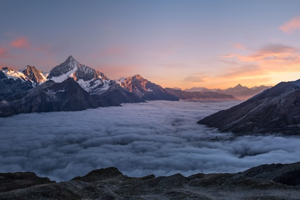
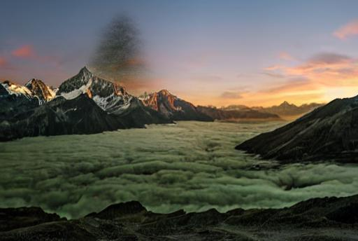
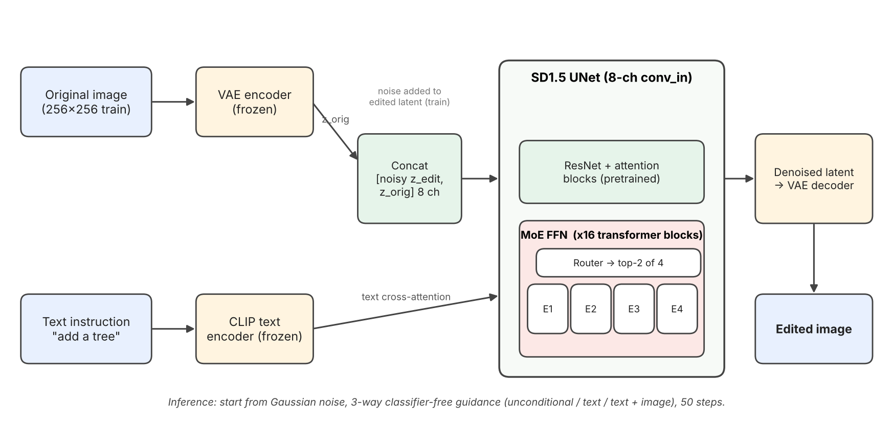

# SD1.5 Mixture-of-Experts for InstructPix2Pix

Instruction-based image editing with Stable Diffusion 1.5, comparing a **Mixture-of-Experts (MoE) UNet** against a **dense baseline**. Both are trained with the InstructPix2Pix recipe (8-channel input, dual classifier-free guidance) on the InstructPix2Pix dataset.

Given an image and a text instruction such as `"add a tree"`, the model returns the edited image.

| Input | Output (`add a tree`) |
|:---:|:---:|
|  |  |

## Architecture



## What's in this repo

| File | Purpose |
|---|---|
| `train_sd15_moe_pix2pix.py` | Trains SD1.5 with MoE feed-forward layers in the UNet |
| `train_sd15_dense_pix2pix.py` | Dense baseline, same recipe without MoE |
| `inference_sd15.py` | Runs an edit from a checkpoint (auto-detects MoE vs dense) |
| `validate_training.py` | Sanity tests (imports, MoE layers, 8-channel UNet, CFG dropout, checkpoint round-trip, forward pass) |
| `requirements.txt` | Python dependencies |
| `architecture.png` | Architecture diagram used in this README |
| `*.slurm` | SLURM job scripts (train, resume, inference, tests) for a 2x A100 cluster |

## How it works

**MoE UNet.** Every `BasicTransformerBlock` feed-forward in the SD1.5 UNet (16 blocks) is replaced with an MoE layer:
- 4 experts, each a standard FFN (`dim -> 4*dim -> dim`, GELU)
- Top-2 gating with softmax over the selected logits
- Load-balancing auxiliary loss (weight `0.01`) averaged across MoE layers
- Experts are freshly initialized; the rest of the UNet starts from pretrained SD1.5 weights

**InstructPix2Pix recipe.**
- `conv_in` is expanded from 4 to 8 channels. The new channels are zero-initialized and the pretrained weights are copied into the first 4.
- The input is the noisy edited latent concatenated with the original-image latent.
- Dual CFG training: with probability 5% each, drop the text prompt, drop the image, or drop both (`--conditioning_dropout_prob`).
- Original image is encoded with the VAE's deterministic `.mode()`, the edited image with `.sample()`.
- Scaled-linear beta schedule, epsilon prediction, AdamW with cosine LR decay, optional mixed precision.
- Inference uses 3-way guidance (unconditional / text / text + image) with separate text and image guidance scales.

## Setup

```bash
git clone <your-repo-url>
cd <your-repo>
pip install -r requirements.txt
```

Training uses the InstructPix2Pix dataset saved to disk in Hugging Face `datasets` format (columns `original_image`, `edited_image`, `edit_prompt`). It was trained on 313,010 samples.

## Training

Single node, multi-GPU:

```bash
torchrun --nproc_per_node=2 train_sd15_moe_pix2pix.py \
    --dataset_path /path/to/instructpix2pix \
    --output_dir /path/to/output \
    --epochs 10 --batch_size 4 --resolution 256 \
    --num_experts 4 --moe_aux_weight 0.01 \
    --mixed_precision
```

Dense baseline: same command with `train_sd15_dense_pix2pix.py` (drop the MoE flags).

Resume: add `--resume_from /path/to/latest_checkpoint.pt`.

Key arguments:

| Arg | Default | Notes |
|---|---|---|
| `--learning_rate` | `5e-5` | Diffusers default; the original paper used `1e-4` |
| `--conditioning_dropout_prob` | `0.05` | Required for dual CFG at inference |
| `--num_experts` | `4` | Top-2 routing |
| `--moe_aux_weight` | `0.01` | Load-balancing loss weight |
| `--resolution` | `256` | Training resolution |
| `--save_every` | `1000` | Also writes `latest_checkpoint.pt` and `best_checkpoint.pt` each epoch |

On a SLURM cluster, adapt `train_sd15_moe_pix2pix.slurm` (paths, partition, conda env) and run `sbatch train_sd15_moe_pix2pix.slurm`. To resume: `sbatch resume_sd15_moe.slurm <checkpoint_path>`.

## Inference

```bash
python inference_sd15.py \
    --checkpoint /path/to/best_checkpoint.pt \
    --input_image test_input.jpg \
    --prompt "add a tree" \
    --output test_output.jpg \
    --guidance_scale 7.5 --image_guidance_scale 1.5 --num_steps 50
```

Raising `--image_guidance_scale` keeps the output closer to the input; raising `--guidance_scale` follows the instruction more strongly.

## Validate before a long run

```bash
python validate_training.py --test_mode quick                       # no dataset needed
python validate_training.py --test_mode full --dataset_path /path/to/instructpix2pix
```

## Model size

| Model | UNet parameters | Source |
|---|---|---|
| SD1.5 UNet (original, 4-channel input) | 859,520,964 | Measured by `validate_training.py` |
| SD1.5 + MoE (8-channel input, 16 MoE FFNs) | 1,107,527,684 (1.29x) | Measured by `validate_training.py` |
| Dense baseline (8-channel input) | ~859.5M | Not logged; the 8-channel `conv_in` adds 11,520 parameters to the original count |

## Training results

All numbers below are **training loss** from the MoE run logs. No held-out validation split or image-quality metric (FID, CLIP score, etc.) was computed.

| Epoch | Avg. MSE loss | Avg. aux (load-balance) loss |
|---|---|---|
| 1 | 0.1328 | 1.0051 |
| 10 | 0.1214 | 1.0011 |
| 18 | 0.1189 | 1.0009 |
| 24 | 0.1187 | 1.0007 |

- Dataset: 313,010 training samples, 4,890 steps per epoch in the final resumed configuration.
- The run was resumed several times with a changed epoch target (10, then 20, 25 and 40) and a larger batch size, so it is not a single uninterrupted schedule. The last epoch average recorded in the logs is epoch 24 of 40.
- The sample image above was produced from the epoch-10 checkpoint (step 252,000).
- The auxiliary loss stays at about 1.00, the value for balanced routing. That shows the experts are used evenly. It does not show they have specialised.
- **No comparison between the MoE and dense models has been run, so this repo makes no claim that MoE is better.** The dense training script is provided as the baseline for that comparison.

### Sanity checks

`validate_training.py` ran 8 of 8 checks successfully on an A100: imports, normalization, CFG dropout rates (about 5% each for text-only, image-only, both), MoE layer forward/backward, checkpoint save/load, 8-channel UNet conversion (16 MoE layers), a full forward/backward step, and dataset loading. These verify the code paths. They are not a measure of model quality.

## Limitations

- **The MoE layer is not sparse in compute.** `MoEFeedForward.forward` runs every expert on every token (`torch.stack([expert(x_flat) for expert in self.experts])`), then uses `torch.gather` to pick the top-2 outputs and weights them with the router's softmax. The routing is therefore mathematically correct top-2, but all 4 experts are always computed, so the layer costs about 4 FFNs of compute rather than 2. The model has more parameters than dense SD1.5 without any compute saving. Real sparse dispatch (grouping tokens by expert, with capacity limits) would be needed to get one.
- The load-balancing loss follows the Switch Transformer form, using the top-1 assignment for the density term.
- Experts are initialized randomly rather than copied from the pretrained FFN, so the MoE model starts further from SD1.5 than a dense fine-tune would.
- Inference resizes every input to 512x344, so it suits only landscape images of about that ratio.
- DDP is run with `find_unused_parameters=True`, which the logs warn is unnecessary and slows each step.

## References

1. R. Rombach, A. Blattmann, D. Lorenz, P. Esser, B. Ommer. *High-Resolution Image Synthesis with Latent Diffusion Models.* CVPR 2022. [arXiv:2112.10752](https://arxiv.org/abs/2112.10752)
2. T. Brooks, A. Holynski, A. A. Efros. *InstructPix2Pix: Learning to Follow Image Editing Instructions.* CVPR 2023. [arXiv:2211.09800](https://arxiv.org/abs/2211.09800)
3. N. Shazeer, A. Mirhoseini, K. Maziarz, A. Davis, Q. Le, G. Hinton, J. Dean. *Outrageously Large Neural Networks: The Sparsely-Gated Mixture-of-Experts Layer.* ICLR 2017. [arXiv:1701.06538](https://arxiv.org/abs/1701.06538)
4. W. Fedus, B. Zoph, N. Shazeer. *Switch Transformers: Scaling to Trillion Parameter Models with Simple and Efficient Sparsity.* JMLR 2022. [arXiv:2101.03961](https://arxiv.org/abs/2101.03961)
5. J. Ho, A. Jain, P. Abbeel. *Denoising Diffusion Probabilistic Models.* NeurIPS 2020. [arXiv:2006.11239](https://arxiv.org/abs/2006.11239)
6. J. Ho, T. Salimans. *Classifier-Free Diffusion Guidance.* NeurIPS 2021 Workshop. [arXiv:2207.12598](https://arxiv.org/abs/2207.12598)

Code and models: [InstructPix2Pix](https://github.com/timothybrooks/instruct-pix2pix), [Stable Diffusion 1.5](https://huggingface.co/runwayml/stable-diffusion-v1-5), Hugging Face [`diffusers`](https://github.com/huggingface/diffusers).

## Acknowledgements

Trained on ASU's Sol cluster (2x A100 per job).

## License

Add a license before publishing (MIT is a common choice). Note that Stable Diffusion 1.5 weights and the InstructPix2Pix dataset have their own licenses.
